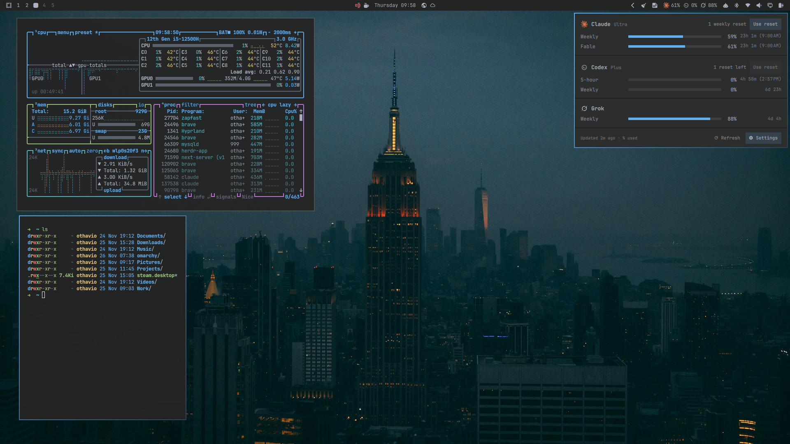
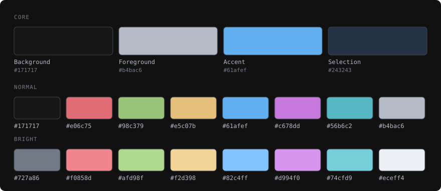
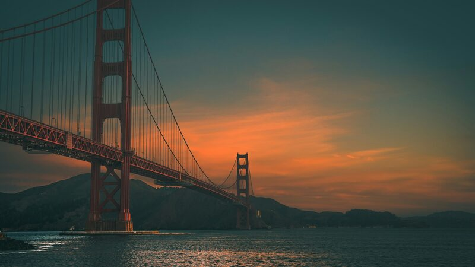
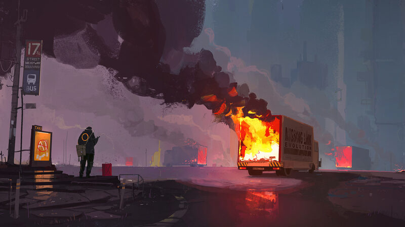
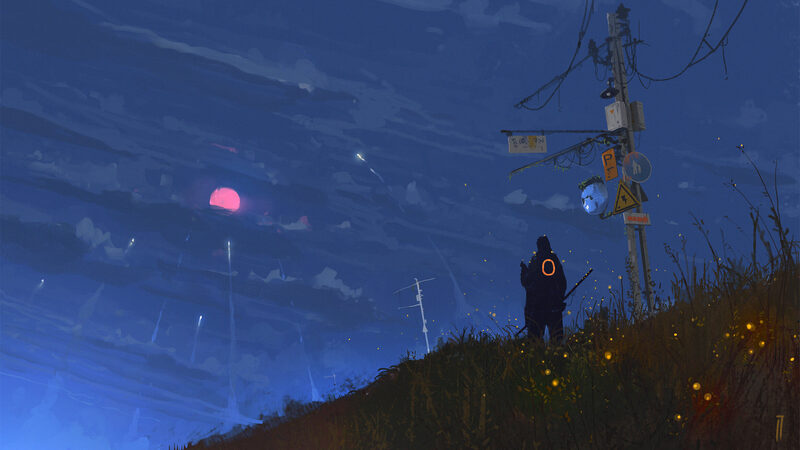
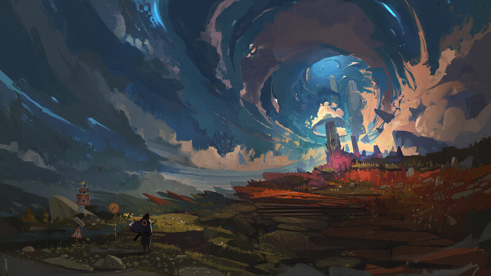

# Omarchy Noctua Theme

Neutral One Dark Pro palette for Omarchy/Hyprland, built on a near-black `#171717` base. It ships matching terminal, shell, editor, and app colors plus seven wallpapers.



## Requirements

Omarchy 4 (Quattro) or newer.

## Install

```bash
omarchy-theme-install https://github.com/othavi0/omarchy-noctua-theme
```

The installer clones the theme and applies it. To come back to it later, pick Noctua in the theme menu or run:

```bash
omarchy-theme-set noctua
```

Pull new versions with `omarchy-theme-update`, and uninstall with `omarchy-theme-remove noctua`.

## Palette

Noctua keeps the One Dark Pro syntax family while moving the desktop base to a neutral `#171717`. The primary Omarchy accent is `#61afef`, body text sits at 9.2:1 over the background, and muted text at 4.1:1. The bright row is a real lighter step of each hue.



## What's included

### Applied by Omarchy

`omarchy-theme-set noctua` applies these on its own.

- `colors.toml` is the source Omarchy generates from. That covers the terminals (Alacritty, Kitty, Ghostty, Foot), the active and inactive Hyprland window borders, the omarchy-shell surfaces (bar, launcher, notifications, popups, lock screen), the Neovim, VS Code, Helix and Obsidian themes, Qt apps, the keyboard backlight, and the Herdr and Claude Code app themes.
- `shell.menu.toml` and `shell.launcher.toml` restyle the omarchy-shell menu and launcher with a darker card, a blue gradient border and a blue selected row.
- `shell.lock.toml` gives the lock screen input the same darker card and gradient border.
- `btop.theme` colors btop.
- `chromium.theme` sets the Chromium frame color.
- `icons.theme` selects the Yaru-blue icon theme.
- `backgrounds/` holds the seven wallpapers below.

### Manual extras

Omarchy does not apply these. Copy the ones you want into each app's config.

- `gtk.css` holds GTK4/libadwaita color overrides.
- `steam.css` holds color overrides for the Adwaita for Steam skin.
- `vencord.theme.css` is a Discord theme for Vencord.
- `firefox.css` holds base16 color variables for a Firefox `userChrome.css`.
- `warp.yaml` is a Warp terminal theme.
- `bat/Noctua.tmTheme` is a bat syntax theme.
- `aether.override.css` and `aether.zed.json` are Aether and Zed overrides.
- `vscode.settings.snippet.jsonc` holds token refinements scoped to the One Dark Pro VS Code theme. They do nothing under the Omarchy theme that VS Code gets by default.

## Motion and shadow (opt-in)

Themes installed from git cannot ship Lua, so Omarchy drops any `*.lua` file from them. To get the Noctua window shadow and animation curves, paste this block into `~/.config/hypr/looknfeel.lua`. It stays active when you switch to another theme.

```lua
hl.config({
  decoration = {
    shadow = { enabled = true, range = 10, render_power = 3, color = "rgba(00000099)", offset = { 2, 2 } },
  },
})
hl.curve("noctua",   { type = "bezier", points = { { 0.55, 0.02 }, { 0.38, 0.98 } } })
hl.curve("midnight", { type = "bezier", points = { { 0.70, 0.01 }, { 0.30, 1.00 } } })
hl.animation({ leaf = "windows",     enabled = true,  speed = 4, bezier = "noctua" })
hl.animation({ leaf = "windowsIn",   enabled = false })
hl.animation({ leaf = "windowsOut",  enabled = false })
hl.animation({ leaf = "windowsMove", enabled = true,  speed = 3, bezier = "noctua" })
hl.animation({ leaf = "fade",        enabled = true,  speed = 4, bezier = "midnight" })
hl.animation({ leaf = "fadeIn",      enabled = true,  speed = 4, bezier = "midnight" })
hl.animation({ leaf = "fadeOut",     enabled = true,  speed = 3, bezier = "midnight" })
hl.animation({ leaf = "workspaces",  enabled = true,  speed = 3, bezier = "midnight", style = "fade" })
```

## Wallpapers

Click any thumbnail for the full-resolution file.

| | | |
| --- | --- | --- |
| [](backgrounds/00-city-dusk.jpg) | [](backgrounds/01-lunar-arc.jpg) | [](backgrounds/02-alpine-ridge.jpg) |
| `00-city-dusk.jpg` | `01-lunar-arc.jpg` | `02-alpine-ridge.jpg` |
| [](backgrounds/03-golden-gate.jpg) | [](backgrounds/04-burning-van.jpg) | [](backgrounds/05-red-moon-hill.jpg) |
| `03-golden-gate.jpg` | `04-burning-van.jpg` | `05-red-moon-hill.jpg` |
| [](backgrounds/06-sky-vortex.jpg) | | |
| `06-sky-vortex.jpg` | | |

## Changing the palette

Every color lives in `colors.toml`. The manual extras, the `shell.*.toml` files and the palette image repeat those values by hand, so update them in the same change.
